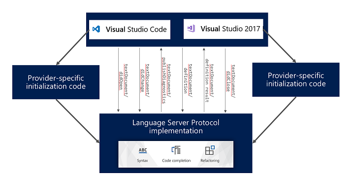

Notepad is probably not the best tool for writing code. We use IDEs because they provide helpers for writing code, such as syntax highlighting, code completion... And as easy as it looks, the logic behind this varies a lot from one language to another. So we need to write some code for each language to help us write code. How can we do this? There are multiple solutions, but one that stands out from the others is a language server.

# What is a language server

A language server is a server (duh) that is responsible for helping programmers by providing them with helpful features. These features could be:

- **Diagnostics**: send feedback about the code you are writing (aka. linting).
- **Hover**: provide information when you hover your cursor over some point in your code.
- **Completion**: suggest code as you type.
- **Goto**: when clicking on a symbol, find its definition & go to it.
- A lot more...

These features are not automatic: you need code to analyze what you are writing and interpret it as you type. That's what a language server does. As it's a server, we need a client, which will most of the time be an extension in your favorite IDE.

You can find some famous language server extensions, such as [rust-analyzer](https://rust-analyzer.github.io/) for Rust.

But instead of writing your own client / server protocol, why not use something that already exists and is already supported by some IDEs? This is the [language server protocol](https://microsoft.github.io/language-server-protocol/), or LSP as some call it, and that is what rust-analyzer is based on.

# Language server protocol (LSP)

The language server protocol is an open standard protocol for writing language servers, based on JSON-RPC. With this protocol, you just have to pick a library for your server that adheres to it (such as the Rust crate [lsp-server](https://crates.io/crates/lsp-server), the LSP library used by rust-analyzer) and write features with it. The client will then be quite straightforward if your IDE supports it.

*Caption from [learn.microsoft.com](https://learn.microsoft.com/en-us/visualstudio/extensibility/adding-an-lsp-extension?view=vs-2022)*

Some IDEs support LSP out of the box. It was originally developed for VS Code, but it is now open, and others such as IntelliJ, Visual Studio, Neovim and many more have added support for it (you can find a non-exhaustive list [here](https://microsoft.github.io/language-server-protocol/implementors/tools/)). Writing a server following LSP means it can be used by all these IDEs (though you still need to write some more or less simple client code).

What is nice about LSP is that the server can be written in any language. Pick your language, find a library following the protocol (or make your own if you have time to spare), write your server with all the functionality you need, and profit! There are lots of SDKs available for many languages, and you can find a list in the [Microsoft specifications](https://microsoft.github.io/language-server-protocol/implementors/sdks/).

Personally, I chose to go with Rust as it's a performant language that has a lot of tools available for language servers. Plus, it compiles easily to the WASI target, and VS Code offers a really nice feature with it that I will present to you.

## WASI language server

Visual Studio Code has a web version available at [vscode.dev](https://vscode.dev). But not all extensions are compatible, and you need to set up your package.json correctly so that they can run on this version. As we are on the web, we cannot run executables for security reasons. So no language server then? Except that now, they provide an extension that makes WASI executables able to run on the web. And you can compile native code to [WASI](https://wasi.dev/) (with some limitations inherent to the WASI specification, such as no networking, a limited file system...). For now, C++ and Rust are the two most compatible languages.

You can find more about it on the [Visual Studio Code blog](https://code.visualstudio.com/blogs/2023/06/05/vscode-wasm-wasi). There is also a two-part implementation tutorial ([part 1](https://code.visualstudio.com/blogs/2024/05/08/wasm) & [part 2](https://code.visualstudio.com/blogs/2024/06/07/wasm-part2)).

The most interesting things about WASI is that you will get performance closer to native than a full javascript implementation. It is still running in a virtual machine, so don't expect a full native performance experience, but you will get closer ! And with Rust, compilation is so easy, you just install the target with `rustup target add wasm32-wasip1`, and you can compile it directly ! Nothing more, nothing less. And you can even link C++ library into it such as glslang which fully compile to WASI !

# Shader language server

Now the part about shaders. There are already some good extensions for shaders in VS Code, but with some limitations:
- [HLSL Tools](https://marketplace.visualstudio.com/items?itemName=TimGJones.hlsltools): probably the best HLSL extension, which made it into Visual Studio as the default HLSL extension. The issue is that it's not maintained anymore, and it's not easy to maintain as it reimplements a whole HLSL compiler to lint shaders. It does not support the latest HLSL features from DXC, such as enums.
- [Shader languages support for VS Code](https://marketplace.visualstudio.com/items?itemName=slevesque.shader): a nice extension for GLSL & HLSL, but not maintained anymore either. There are no diagnostics, only a symbol provider. Some compatible extensions are available to add linting, but they rely on glslang & the DirectX Shader Compiler and require them to be installed as dependencies.
- [WGSL](https://marketplace.visualstudio.com/items?itemName=PolyMeilex.wgsl): a nice extension for WGSL, but it only supports linting and requires an external installation of the server.

These were some nice extensions, but none of them really fit my needs, so I decided to make my own language server for shaders with these requirements:
- Rely on LSP for IDE compatibility.
- Rely on standard APIs for validation.
- Run on the web version of VS Code using WASI.
- Bundle the server into the extension to make it work out of the box.
- Provide symbols (which came up later).
- Support more than one shader language.

That's a lot of requirements, but I finally came up with [shader validator](https://marketplace.visualstudio.com/items?itemName=antaalt.shader-validator).

It supports HLSL, GLSL & WGSL and is written in Rust. Diagnostics are run by standard API validators (glslang, DXC, Naga) and symbols are provided by [tree-sitter](https://tree-sitter.github.io/tree-sitter/). Everything is bundled in the extension, so it should work out of the box, even on the web version of VS Code thanks to WASI.

In a next post, I will explain more about the tech inside it! Until then, go try it out in [vscode](https://marketplace.visualstudio.com/items?itemName=antaalt.shader-validator) !

# Interesting resources

- [bytecodealliance.org - WASI 0.2](https://bytecodealliance.org/articles/WASI-0.2)
- [microsoft.github.io - Language Server Protocol](https://microsoft.github.io/language-server-protocol/)
- [github.com - vscode-wasm](https://github.com/microsoft/vscode-wasm)
